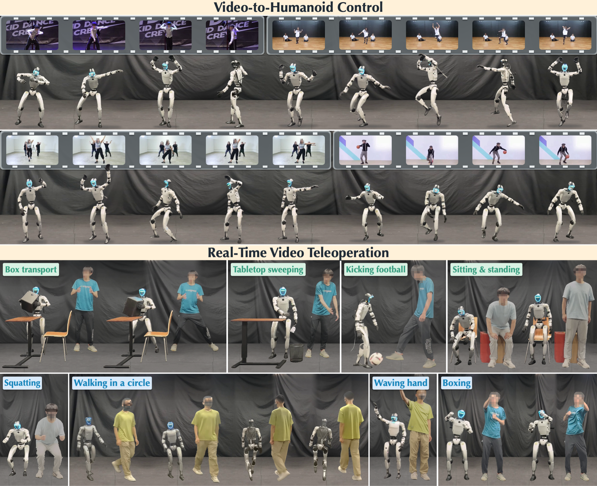

<div align="center">

# Long-Horizon Humanoid Control with ViT-H:<br/>Subspace Diffusion-PPO and Model Soup

<a href="https://github.com/Hsch22/vit-h-ppo"></a>
<a href="https://www.modelscope.cn/models/Jasonhsc/vit-h-ppo"></a>
<a href="https://arxiv.org/abs/2610.32966"></a>
<a href="https://awfuact.github.io/vit-h/"></a>

</div>



This repository investigates **closed-loop online reinforcement learning, weight-space policy fusion, and synchronized long-horizon inference** for generative video-to-humanoid control on the Unitree G1, building directly upon [ViT-H](https://arxiv.org/abs/2610.32966) (`base/vith-release-2482c5c`). Without modifying the frozen SONIC whole-body tracking controller or adding inference overhead, our framework resolves cross-window boundary discontinuities, short-to-long-horizon global trajectory drift, and the agility–stability trade-off of online Diffusion-PPO.

---

## Overview & Key Contributions

1. **Difficulty-Curated, Velocity-Preserving Diffusion-PPO (`post_training/`):**
   - Full-dataset MuJoCo trackability mining across 57,231 clips (`Human3.6M`, `BEDLAM`, `BEDLAM2.0`) filters out physically untrackable retargeted references (`4.7%–6.9%`) and concentrates critic-free group rollouts (`G=8`, stochastic `DDIM-20, eta=0.7`, terminal `sigma=0` step masked) on fast dynamic failures and high-drift clips using an additive velocity-preserving reward (`decomposed_vel`).
2. **Orthogonal Long-Horizon Stitching (`post_training/stitching.py`, `tools/infer_video.py`):**
   - Demonstrates that 97% of cross-window seam discontinuities arise from boundary context asymmetry during independent denoising rather than suboptimal policy weights. Combining **shared-noise MultiDiffusion** consensus over 16-frame overlaps, **gravity-preserving yaw alignment**, and geodesic SLERP + exact FK blending cuts seam jumps by **72.6%** at **+0.9%** runtime cost and composes strictly additively with PPO (**94.13%** on 392 long test sequences, surpassing retargeted ground truth at **93.37%**).
3. **Subspace-Anisotropic KL & Zero-Training 50/50 Linear-Basin Model Soup:**
   - Regularizing the 9-D incremental global root subspace (`[180:189]`) sixfold (`hard_ppo_subspace_kl_step1200.pt`) suppresses **75%–114%** of world-frame trajectory drift while backpropagating uniformly across all 16 Transformer self-attention blocks (`~13%` trunk damping, `cos = +0.486` against uniform-KL).
   - Full-network 50/50 linear interpolation (`hard_ppo_model_soup_50_50_step1200.pt`) preserves cross-layer trunk–head phase coherence inside a broad zero-regression basin (`alpha in [0.35, 0.65]`, **92.80%** `+4/-0`), outperforms norm-matched WiSE-FT and readout-head grafting controls, and achieves **super-linear physical execution**:
     - **External 8-method EMDB & RICH physical benchmark:** Ranks **#1 in 9/24 cells (8 solo #1)** and **top-2 in 19/24 cells**, including **solo #1 on EMDB VO Long Success (41.67%, the only method >40%)**, **#1 lowest mechanical power across all 4 settings**, and **#1 lowest EMDB GT/VO foot slip**.
     - **In-the-wild dance videos (8 videos × 3 seeds = 24 rollouts):** **100.0% (24/24)** survival and **#1 lowest execution root error (0.2389 m)** across all evaluated configurations.

---

## Benchmark Results

### 1. External Physical Executability on EMDB & RICH (Frozen SONIC Tracker in MuJoCo)

| Setting | Method | Push Succ. (%) ↑ | Foot slip (cm/s) ↓ | P95 GRF (BW) ↓ | Power (W) ↓ | Long Succ. (%) ↑ | Long MPJPE (mm) ↓ |
| --- | --- | ---: | ---: | ---: | ---: | ---: | ---: |
| **EMDB (GT)** | Best Recon.+GMR (`GEM† + GMR`) | 75.00 | 3.308 | 1.828 | 89.80 | 33.33 | **223.73** |
| | ViT-H (w/o PT) | 88.91 | 2.696 | 1.594 | 75.75 | **37.50** | 236.74 |
| | Uniform-KL PPO (`decomposed_step1200`) | **91.04** | 2.698 | 1.595 | 75.66 | **37.50** | 237.52 |
| | Root-KL PPO (`subspace_kl_step1200`) | 89.22 | 2.685 | 1.615 | 75.93 | **37.50** | 236.71 |
| | **Ours (50/50 Model Soup)** | 90.23 | **2.613** | **1.588** | **74.87** | **37.50** | 237.40 |
| **EMDB (VO)** | Best Recon.+GMR (`GVHMR† / GEM + GMR`) | 74.37 | 3.257 | 1.817 | 87.02 | 33.33 | **236.49** |
| | ViT-H (w/o PT) | 88.91 | 2.743 | 1.627 | 76.63 | 37.50 | 241.34 |
| | Uniform-KL PPO (`decomposed_step1200`) | **90.91** | 2.702 | 1.616 | 75.92 | 37.50 | 243.67 |
| | Root-KL PPO (`subspace_kl_step1200`) | 89.22 | 2.703 | **1.612** | 76.51 | 37.50 | 242.23 |
| | **Ours (50/50 Model Soup)** | 89.72 | **2.672** | 1.620 | **74.93** | **41.67** | 241.69 |
| **RICH (VO)** | Best Recon.+GMR (`GVHMR / GEM† + GMR`) | 90.28 | 1.953 | 1.451 | 61.12 | 88.89 | 200.75 |
| | ViT-H (w/o PT) | 98.61 | **1.830** | 1.424 | 60.83 | **91.67** | 199.35 |
| | Uniform-KL PPO (`decomposed_step1200`) | **100.00** | 1.892 | 1.406 | 60.27 | 83.33 | **199.03** |
| | Root-KL PPO (`subspace_kl_step1200`) | 98.61 | 1.871 | **1.388** | 60.37 | 86.11 | 199.49 |
| | **Ours (50/50 Model Soup)** | 98.61 | 1.849 | 1.405 | **59.99** | 83.33 | 199.32 |

### 2. Controlled Weight-Space & Multi-Window Stitching Ablations (`DDIM-50, eta=0.0`)

| Configuration | `test` Drift-125 Long (%) ↑ | Paired vs. w/o PT | `test` H36M Long (%) ↑ | Peak Z-Drift (mm) ↓ | `test` Hard Root Err (mm) ↓ | Real Dance (8×3) Pass / Root Err ↓ |
| --- | ---: | :---: | ---: | ---: | ---: | :---: |
| ViT-H (w/o PT, 1-frame `SO(3)`) | — | — | — | — | — | 95.8% (23/24) / 0.2842 m |
| ViT-H (w/o PT, 16f Yaw + MultiDiff) | 89.60 | — | 62.50 | 74.1 | 165.8 | **100.0%** (24/24) / 0.2391 m |
| Root-KL PPO (`alpha = 0.00`) | **92.80** | **+4 / -0** | 68.75 | **73.2** | **159.7** | **100.0%** (24/24) / 0.2406 m |
| **Ours: 50/50 Model Soup (`alpha = 0.50`)** | **92.80** | **+4 / -0** | **75.00** | 75.2 | 160.3 | **100.0% (24/24) / 0.2389 m** |
| Uniform-KL PPO (`alpha = 1.00`) | 90.40 | +4 / -3 | **75.00** | 77.5 | 162.7 | **100.0%** (24/24) / 0.2480 m |
| Norm-Matched WiSE-FT (`0.81 dW_uni`) | 91.20 | +4 / -2 | **75.00** | 76.3 | 164.1 | — |
| Readout-Head Graft (`Uni trunk + Root head`) | 91.20 | +4 / -2 | **75.00** | 77.9 | 161.6 | — |

---

## Installation

We recommend two isolated Python 3.10 environments: `vith-base` (CUDA / PyTorch / SAM 3D Body for generation & PPO training) and `vith-tracker` (MuJoCo + ONNX Runtime for SONIC tracking). Full environment details are in [docs/DEPLOYMENT.md](docs/DEPLOYMENT.md).

```bash
git clone https://github.com/Hsch22/vit-h-ppo.git
cd vit-h-ppo

# 1. Generator & post-training environment (Linux, CUDA 12.1)
conda create -n vith-base python=3.10 -y
conda activate vith-base
pip install -r requirements.txt
pip install -r requirements-sam3d.txt
pip install -e .

# 2. Fast-SAM-3D-Body image feature extractor
mkdir -p third-party
git clone https://github.com/yangtiming/Fast-SAM-3D-Body.git third-party/Fast-SAM-3D-Body

# 3. Isolated MuJoCo + SONIC whole-body tracker environment
conda create -n vith-tracker python=3.10 -y
conda activate vith-tracker
pip install -r g1_tracker/requirements-tracker.txt
```

*(Optional)* For `--use-dpvo` camera trajectory estimation (SimpleVO runs out-of-the-box without extra compilation), install [DPVO](https://github.com/princeton-vl/DPVO) under `third-party/DPVO`:

```bash
git clone --recursive https://github.com/princeton-vl/DPVO.git third-party/DPVO
wget https://gitlab.com/libeigen/eigen/-/archive/3.4.0/eigen-3.4.0.zip -O /tmp/eigen-3.4.0.zip
unzip /tmp/eigen-3.4.0.zip -d third-party/DPVO/thirdparty
pip install ./third-party/DPVO
```

---

## Model Checkpoints

### 1. Post-Trained Diffusion-PPO & Model Soup Weights (ModelScope)

Weights-only `float32` inference checkpoints (`~899 MB` each, `imgfeat_encoder="sam3d"`, strict `load_pipeline` compatible, SHA-256 verified in `manifest.json`) are hosted at [ModelScope `Jasonhsc/vit-h-ppo`](https://www.modelscope.cn/models/Jasonhsc/vit-h-ppo):

| Checkpoint Path | Method | Steps | Size | SHA-256 (prefix) | Primary Use Case |
| --- | --- | ---: | ---: | --- | --- |
| **`checkpoints/hard_ppo_model_soup_50_50_step1200.pt`** | **50/50 Model Soup** (`0.5 W_uni + 0.5 W_root`) | 1200 | 898.85 MB | `1c2e2ca4b4149739` | **Recommended Default** — best overall physical execution (EMDB VO Long `41.67%` #1, lowest Power across all 4 settings, Dance root err `0.2389 m` #1, `test` 125 `92.80% +4/-0`) |
| `checkpoints/hard_ppo_subspace_kl_step1200.pt` | Root-KL `6×` on `[180:189]` | 1200 | 898.86 MB | `864329b22dfb2aa8` | Strictest global-drift & impact-force control (EMDB/RICH drift `-75%` to `-114%`, RICH P95 GRF `1.388 BW` #1) |
| `checkpoints/hard_ppo_decomposed_step1200.pt` | Uniform-KL Diffusion-PPO (`decomposed_vel`) | 1200 | 898.86 MB | `c49cd815796bafd4` | Peak external disturbance rejection (`94.13%` test 392, `91.04%` EMDB / `100.0%` RICH Push Success) |
| `checkpoints/hard_ppo_decomposed_step0900.pt` | Uniform-KL Diffusion-PPO (`decomposed_vel`) | 900 | 898.86 MB | `a0c5e44cfa16d177` | Short-window dynamic clip recovery (`7/22` fixable dynamic test clips) |
| `checkpoints/pilot_uniform_step0500.pt` | Uniform-Sampling PPO (`combined_track`) | 500 | 898.86 MB | `3f27f94248e26157` | Ablation baseline: uniform sampling + multiplicative reward |
| `checkpoints/stitched_seam_step0800.pt` | Dual-Window Seam PPO (`stitched_seam`) | +800 | 898.86 MB | `e5f48331c8e5c6f7` | Ablation baseline: two-window seam penalty negative result |

```bash
pip install modelscope

# Download the recommended 50/50 Model Soup checkpoint
modelscope download --model Jasonhsc/vit-h-ppo \
  checkpoints/hard_ppo_model_soup_50_50_step1200.pt \
  --local_dir ./inputs/checkpoints/vith_ppo
```

### 2. Upstream Preprocessing, Base Generator, & Tracker Assets

Download the pre-trained ViT-H base checkpoint, detector/pose/VO weights, and frozen SONIC ONNX tracker from [`eerrr1/ViT-H-checkpoints`](https://huggingface.co/datasets/eerrr1/ViT-H-checkpoints):

```bash
mkdir -p inputs/checkpoints/g1_tracker

hf download eerrr1/ViT-H-checkpoints \
  vith_offline_g1.ckpt \
  inputs/checkpoints/dpvo/dpvo.pth \
  inputs/checkpoints/hmr2/epoch=10-step=25000.ckpt \
  inputs/checkpoints/vitpose/vitpose-h-multi-coco.pth \
  inputs/checkpoints/yolo/yolov8x.pt \
  --repo-type dataset \
  --local-dir .

hf download eerrr1/ViT-H-checkpoints \
  model_step_020000_g1.onnx \
  --repo-type dataset \
  --local-dir inputs/checkpoints/g1_tracker
```

Register and place [SMPL](https://smpl.is.tue.mpg.de/) and [SMPL-X](https://smpl-x.is.tue.mpg.de/) models under `inputs/checkpoints/body_models/{smpl/SMPL_{GENDER}.pkl, smplx/SMPLX_{GENDER}.npz}`, and place the Fast-SAM-3D-Body network (`model.ckpt`) and MHR asset (`mhr_model.pt`) under `third-party/Fast-SAM-3D-Body/checkpoints/sam-3d-body-dinov3/`. You can verify asset SHA-256 digests anytime via `python scripts/checkpoints.py list`.

---

## Video-to-Humanoid Inference & MuJoCo Tracking

`tools/infer_video.py` resamples input videos to 30 FPS while preserving duration, validates preprocessing caches by content hash, enforces `sam3d` feature compatibility, and defaults to **16-frame overlap + gravity-preserving `yaw` alignment + raised-cosine/SLERP+FK blending + shared-noise `multidiffusion` synchronization**:

```bash
# 1. Generate seamless long-horizon Unitree G1 reference motion from monocular video
conda activate vith-base
python tools/infer_video.py \
  --video /path/to/input.mp4 \
  --ckpt inputs/checkpoints/vith_ppo/checkpoints/hard_ppo_model_soup_50_50_step1200.pt \
  --sam3d-root third-party/Fast-SAM-3D-Body \
  --sam3d-ckpt-path third-party/Fast-SAM-3D-Body/checkpoints/sam-3d-body-dinov3/model.ckpt \
  --sam3d-mhr-path third-party/Fast-SAM-3D-Body/checkpoints/sam-3d-body-dinov3/assets/mhr_model.pt \
  --output outputs/inference/input_g1.npz

# 2. Execute & evaluate in MuJoCo (50 Hz SONIC control, 1 kHz physics, optional --render-video)
conda activate vith-tracker
PYTHONPATH=g1_tracker python g1_tracker/tools/track_g1.py \
  --input outputs/inference/input_g1.npz \
  --output outputs/inference/tracked_g1.npz \
  --render-video --video-output outputs/inference/tracked_g1.mp4
```

**Useful inference flags** (see [docs/INFERENCE.md](docs/INFERENCE.md) for full details):
- `--static-cam`: Use for fixed-tripod videos; otherwise SimpleVO runs by default (or pass `--use-dpvo`).
- `--ckpt vith_offline_g1.ckpt` and `--overlap 1 --align-mode so3 --sync-mode none`: Reproduces the upstream pre-trained baseline and legacy 1-frame rigid endpoint stitching bit-for-bit.
- `--force-recompute` / `--force-recompute-imgfeat`: Rebuild cached preprocessing artifacts (`camera_K.pt` is preserved). Use distinct `--output-root` directories when launching concurrent jobs on the same video stem.

---

## Dataset Preparation & Training

### 1. Preprocessed Datasets

Download the preprocessed `amass`, `bedlam`, `bedlam2`, and `h36m` archives from [`eerrr1/ViT-H`](https://huggingface.co/datasets/eerrr1/ViT-H) (obtained under each upstream dataset's research terms; see [docs/DATA_LAYOUT.md](docs/DATA_LAYOUT.md)):

```bash
hf download eerrr1/ViT-H --repo-type dataset --local-dir /path/to/training_set
cd /path/to/training_set
for archive in amass bedlam bedlam2 h36m; do
  tar --use-compress-program=unzstd -xf "${archive}.tar.zst"
done
export VITH_DATASET_ROOT=/path/to/training_set
```

*(For full base pre-training only)* Optionally download [`bones-studio/seed`](https://huggingface.co/datasets/bones-studio/seed) (`g1.tar.gz` and `soma_proportional.tar.gz`) after accepting its gated license and convert via `bash tools/bones_seed_preprocessing/run_preprocessing.sh /path/to/bones-seed /path/to/training_set/bones_seed 16` (see [tools/bones_seed_preprocessing/README.md](tools/bones_seed_preprocessing/README.md)).

### 2. Online Diffusion-PPO Post-Training & Model Soup (`post_training/`)

On NVIDIA Hopper (`sm_90`), FlashAttention-backed SDPA, pre-cached RoPE tables, BF16 autocast, and `torch.compile` accelerate 50-step DDIM rollouts (`B=32, L=120`) by **9.11×** (`2193.3 -> 240.6 ms`) and training steps by **3.43×**, while `PersistentTrackerPool` sustains **12.0 trajectories/s** per 16 resident MuJoCo workers over binary pipes with zero disk I/O.

```bash
# Step 1: Mine trackability & difficulty buckets across training clips
python post_training/mine_hard_clips.py \
  --dataset-root "$VITH_DATASET_ROOT" --split train \
  --tracker-python /path/to/envs/vith-tracker/bin/python \
  --output-dir outputs/hard_mining_train

# Step 2a: Train Uniform-KL Diffusion-PPO (pi_uni, 1,200 steps on 8 GPUs)
torchrun --standalone --nproc_per_node=8 post_training/train_ppo.py \
  --dataset-root "$VITH_DATASET_ROOT" \
  --hard-index outputs/hard_mining_train/hard_index.json \
  --reward-mode decomposed_vel --kl-coef 0.01 --kl-root-weight 1.0 \
  --max-steps 1200 --compile-rollout \
  --tracker-python /path/to/envs/vith-tracker/bin/python \
  --output-dir outputs/ppo_uniform_kl_1200

# Step 2b: Train Root-Subspace 6x KL Diffusion-PPO (pi_root, 1,200 steps on 8 GPUs)
torchrun --standalone --nproc_per_node=8 post_training/train_ppo.py \
  --dataset-root "$VITH_DATASET_ROOT" \
  --hard-index outputs/hard_mining_train/hard_index.json \
  --reward-mode decomposed_vel --kl-coef 0.01 --kl-root-weight 6.0 \
  --max-steps 1200 --compile-rollout \
  --tracker-python /path/to/envs/vith-tracker/bin/python \
  --output-dir outputs/ppo_subspace_kl_1200

# Step 3: Evaluate paired long-horizon physical & kinematic drift suites
python post_training/eval_drift_suite.py \
  --dataset-root "$VITH_DATASET_ROOT" --split test --sources h36m bedlam bedlam2 \
  --base-ckpt vith_offline_g1.ckpt \
  --cand soup=inputs/checkpoints/vith_ppo/checkpoints/hard_ppo_model_soup_50_50_step1200.pt \
  --tracker-python /path/to/envs/vith-tracker/bin/python \
  --output-dir outputs/eval_drift_test
```

### 3. Base Generator Pre-Training

To reproduce upstream supervised diffusion pre-training (`16` layers, width `1024`, `16` heads, `120`-frame windows; requires converted `bones_seed`):

```bash
export VITH_DATASET_ROOT=/path/to/training_set
export NUM_DEVICES=8
export WANDB_MODE=offline
bash scripts/train.sh   # or: sbatch slurm/train.sbatch
```

---

## Repository Structure & Documentation

- `post_training/` — Stochastic DDIM policy, velocity-preserving rewards, subspace-anisotropic KL, DDP PPO trainers, MultiDiffusion stitcher, persistent MuJoCo worker pool, and evaluation suites.
- `hmr4d/` — Diffusion Transformer architecture, datasets, video preprocessing, and coordinate endecoders.
- `g1_tracker/` — Frozen SONIC ONNX whole-body controller, Unitree G1 MJCF assets, grounding, and MuJoCo rollout runner ([g1_tracker/README.md](g1_tracker/README.md)).
- `motion_lib/` — Unitree G1 forward kinematics and rotation utilities.
- `tools/` — End-to-end video inference (`infer_video.py`) and BONES-SEED preprocessing.
- `docs/` — Detailed technical guides:
  - [Deployment & Environment Setup](docs/DEPLOYMENT.md)
  - [Diffusion-PPO & Synchronized Stitching Architecture](docs/PPO_INTEGRATION.md)
  - [Validation Benchmarks & Ablation Records](docs/VALIDATION.md)
  - [Inference & Preprocessing Cache Specification](docs/INFERENCE.md)
  - [Dataset Layout](docs/DATA_LAYOUT.md) · [Upstream Import Provenance](docs/SOURCE_IMPORT.md)

---

## Citation

If you build upon ViT-H or this post-training framework, please cite the foundational ViT-H paper:

```bibtex
@article{he2026vith,
  title={ViT-H: Generative Video-To-Humanoid Control with Motion Tracking Feedback},
  author={He, Zimo and Bian, Tianyi and Yang, Zizhong and Li, Hongjie and Jiang, Nan and Cui, Jieming and Jia, Baoxiong and Wang, Yizhou and Huang, Siyuan and Zhu, Yixin},
  journal={arXiv preprint arXiv:2610.32966},
  year={2026}
}
```

## Acknowledgements

This project builds directly on the official release of [**ViT-H**](https://awfuact.github.io/vit-h/) by Zimo He, Tianyi Bian, Zizhong Yang, Hongjie Li, Nan Jiang, Jieming Cui, Baoxiong Jia, Yizhou Wang, Siyuan Huang, and Yixin Zhu. We also thank the authors of [GVHMR](https://github.com/zju3dv/GVHMR), [SAM 3D Body](https://github.com/facebookresearch/sam-3d-body), [Fast-SAM-3D-Body](https://github.com/yangtiming/Fast-SAM-3D-Body), [YOLOv8](https://github.com/ultralytics/ultralytics), [ViTPose](https://github.com/ViTAE-Transformer/ViTPose), [DPVO](https://github.com/princeton-vl/DPVO), [HMR 2.0 / 4D-Humans](https://github.com/shubham-goel/4D-Humans), [GMR](https://github.com/YanjieZe/GMR), [GEM](https://research.nvidia.com/labs/dair/gem/), [SONIC](https://nvlabs.github.io/GEAR-SONIC/), [HoloMotion](https://github.com/HorizonRobotics/HoloMotion), [ScaleBFM](https://github.com/zengweishuai/ScaleBFM), and [Humanoid-GPT](https://github.com/GalaxyGeneralRobotics/Humanoid-GPT) for their publicly available code and models.
